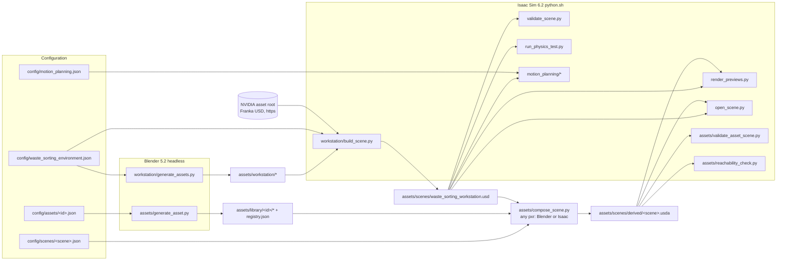

# Architecture

Derived from the source code (October 2026). Paths are relative to `waste-sorting-workstation/`.

## Pipeline overview



`run_workflow.py` (system `python3`) chains GA → BS → VS → PT → RP plus a sandboxed regression of the parent ramp
project; `add_asset.py` (system `python3`) chains GX (once per `--spec`) → CS → VA and optionally VS + PT + RP on the
derived scene. `build_industrial_scene.sh` writes a scene config with the `asset_lib.py` CLI, runs `add_asset.py` for
six assets and then `reachability_check.py`.
Every stage is a separate process; Omniverse code only runs under Isaac Sim's `python.sh`.

## Which code does what

| Question | Answer (from the code) |
|---|---|
| Generates geometry | `generate_assets.py` (all workstation assets, fixed builder list in `main()`); `generate_asset.py` (one library asset from a spec). The workstation is built in Blender (`bpy`, `bmesh`). Library assets go through a **geometry backend** chosen by `backends.select_backend`: Blender builders (default), the optional FreeCAD builder `freecad_build.py` (parametric solid → STEP + tessellation → Blender visual), or an STL/STEP import. On every route Blender is the preparation / USD stage; the CAD routes hand Blender the actual FreeCAD tessellation. Function-level path: [GEOMETRY_BACKENDS.md](GEOMETRY_BACKENDS.md#execution-path-of-the-freecad-route-function-level). |
| Generates physics-ready USD | the same scripts, via `generate_assets.write_asset()` using Blender's bundled `pxr` (UsdPhysics only): colliders, `UsdPhysics` material, `RigidBodyAPI` + `MassAPI`. PhysX-specific attributes (combine modes) are authored later at scene level, because Blender's USD has no `PhysxSchema`. |
| Assembles the workstation | `build_scene.py` (Isaac): deletes and rewrites `assets/scenes/waste_sorting_workstation.usd` from the config, references every asset by relative path and the Franka by URL. |
| Adds objects incrementally | `compose_scene.py`: writes `assets/scenes/derived/<scene>.usda`, which sublayers the base scene and references library assets; it can also deactivate base prims (`active = false` in the derived layer only) and add preview cameras. Pure `Sdf` authoring, so it runs in Blender or Isaac. |
| Registers assets | workstation: `assets/workstation/asset_manifest.json`, rewritten wholesale by `generate_assets.py`. Library: `assets/library/<id>/asset_info.json` per asset, with `assets/library/registry.json` rebuilt from them (`asset_lib.rebuild_registry`). |
| Separates visual and collision | every asset root has `Visual` (a reference to `<name>_visual.usd`, the Blender mesh) and `Collision/*` (UsdGeom Cube/Cylinder/Mesh prims with `purpose = guide` + `CollisionAPI`). The collider geometry is authored separately, not derived from the render mesh. |
| Validates | `validate_scene.py` (static, 94 checks), `run_physics_test.py` (PhysX, 39 checks), `open_scene.py --self-test` (GUI), `validate_asset_scene.py` (derived scenes), `motion_planning/validate_motion.py`. See [VALIDATION.md](VALIDATION.md). |
| Regenerates everything | `run_workflow.py` (without `--skip-assets`), `generate_assets.py` (all 8 builders), `build_scene.py` (whole scene). |
| Runs incrementally | `generate_asset.py` (one asset; skips if spec hash + file hashes are unchanged), `compose_scene.py` (only the derived layer), `run_workflow.py --skip-assets` / `--report-only`, `run_regression.sh` (no rebuild), `render_previews.py --cameras …`. |
| Needs Isaac Sim | `build_scene.py`, `validate_scene.py`, `run_physics_test.py`, `render_previews.py`, `open_scene.py`, `diagnose_gui_physics.py`, `optimize_layout.py`, `validate_asset_scene.py`, `motion_planning/*`. |
| Runs without Isaac Sim | Blender: `generate_assets.py`, `generate_asset.py`, `compose_scene.py`. System python3 (stdlib only): `run_workflow.py` / `add_asset.py` orchestration, `asset_lib.py` (specs, registry, instance editing, self-test), `negative_control.py` (it launches Isaac for the validator). |

## Modules

### `scripts/workstation/`
| Module | Runs in | Responsibility |
|---|---|---|
| `generate_assets.py` | Blender | Geometry helpers (`lathe`, `mesh_object`, `box_object`, `text_object`, `material`), mass properties of closed meshes (`mass_properties`, `combine_mass`), `export_visual` (Blender USD export), `write_asset` (physics asset USD). Builders: table (tabletop, leg, assembled table), glass bottle, PET bottle, paper cup, two bins, crate, crate platform. Writes `asset_manifest.json`. Importable without side effects (main is guarded). |
| `build_scene.py` | Isaac | Scene assembly: physics scene, ground, lights, table, sorting zone, crate bottles (static override), tabletop objects, OmniGlass render overrides, robot (reference by URL, variants, home joint state + drive targets, base/tabletop filtered pair), PhysX combine modes on every material, `/World/Targets` frames, cameras, model kinds. Writes `logs/workstation/scene_build.json`. |
| `layout_geometry.py` | any (numpy) | Analytic OBB model of the scene from the config (`scene_paths`, bin/crate/platform/table boxes, crate cells). Shared by the optimiser and validators. |
| `robot_geometry.py` | Isaac | `RobotModel`: Lula FK/IK for the Franka + the robot's PhysX convex hulls for clearance checks. |
| `manipulation_targets.py` | Isaac | TCP pose sequences for the bins/crate/pickups and their IK + endpoint-clearance evaluation. |
| `layout_validation.py` | Isaac | `layout.*` and `reachability.*` checks for `validate_scene.py`; `usd_static_boxes` (OBBs from the built USD colliders). |
| `optimize_layout.py` | Isaac | Seeded search of the sorting-zone layout; `--apply` writes it into the config. |
| `validate_scene.py` | Isaac | Static validation (USD, geometry, physics schemas, robot structure, layout, reachability). |
| `run_physics_test.py` | Isaac | PhysX tests: settle, robot hold, bin drops, glass-placement stability, scene integrity. |
| `render_previews.py` | Isaac | RTX real-time previews from scene cameras. |
| `open_scene.py`, `gui_physics_guard.py`, `diagnose_gui_physics.py` | Isaac (GUI) | GUI session with model picking + `RigidBodyGuard`; numerical GUI-vs-headless reproduction. |
| `run_workflow.py` | python3 | Orchestration, GPU sampling, parent-project hash check + ramp regression, report. |

### `scripts/assets/` (incremental assets)
| Module | Runs in | Responsibility |
|---|---|---|
| `backends.py` | any Python (stdlib) | Backend capabilities, FreeCAD discovery (`FREECAD_EXECUTABLE`, never starts the GUI), deterministic `select_backend` (decision + rule + reason), spec-level backend errors. |
| `freecad_measure.py` | FreeCAD `freecadcmd` | Comparison only: exact B-rep measurements of a STEP, a 1 µm reference tessellation, exact point-to-solid distances. |
| `mesh_compare.py` | Blender | Comparison only: mesh metrics, feature measurements, sampled two-sided distances to the CAD surface, collider analysis, comparison renders (read-only). |
| `compare_backends.py` | python3 | Orchestrates the two above → `logs/assets/backend_comparison/`, `docs/images/cad_comparison/`. |
| `freecad_build.py` | FreeCAD `freecadcmd` | Parametric `fitting` solid from the spec sections (cylinders, cones, `makeChamfer`, groove cuts, chamfered hex, revolved bore cut; cosmetic threads), or STEP read; validity / bounding box / STEP round trip / tessellation checks; STEP + STL export; exact volume, COM, inertia. |
| `asset_lib.py` | any Python | Paths (`abspath` refuses paths outside the project), tool discovery (`isaac_python`, `blender_bin`), JSON-schema subset validator, spec rules (`spec_errors`), derived values (`nominal_size`, `expected_colliders`), **analytic geometry shared by generator, placement and validators** (`container_dims`, `fitting_sections`, `fitting_zones`, `collider_pieces`, `support_surface`, `mount_frames`), asset status (`missing/stale/modified/failed/current`), registry, scene configs, **instance poses** (`scene_poses`: tabletop / floor / on another instance / attached to a mount point; upright or lying rest pose from the colliders), piece-based placement pre-check, seeded `scatter`, CLI. |
| `generate_asset.py` | Blender | One asset: geometry method (`box`, `cylinder`, `tube`, `open_container`, `fitting`, `label_plate`) → visual mesh (+ sharp-edge shading), mass from mesh volume, colliders (`primitive`, `convex_hull`, `ring_segments`, `container_walls`, `fitting_sections`, `none`; optional PhysX contact offset), `export_visual` + `write_asset`, self-checks, `asset_info.json`, registry. Builds into `<id>.tmp/`, then moves the files into place. |
| `compose_scene.py` | Blender or Isaac | Derived layer from a scene config (see [ASSET_FORMATS.md](ASSET_FORMATS.md#derived-scene-layer)). Refuses stale/missing assets and failing placements. |
| `validate_asset_scene.py` | Isaac | Targeted validation of a derived scene, including session-layer drop tests into containers and a move test of one body. |
| `reachability_check.py` | Isaac | Geometric reachability of pickup/drop poses with `robot_geometry.RobotModel` (Lula IK + endpoint clearance; no motion). |
| `add_asset.py` | python3 | Orchestrator (one or several `--spec`) plus protected-file hashing and a report. |
| `negative_control.py` | python3 → Isaac | Proves the validator rejects a tampered layer. |
| `run_demo.sh` | bash | Reproduces the incremental demonstration (`test_spacer`). |
| `build_backend_comparison.sh` | bash | The four brass-adapter variants upright and labelled on the unchanged workstation (`brass_backend_comparison`). |
| `build_cad_comparison.sh` | bash | Blender vs. FreeCAD vs. STEP-import variants of one fitting on the unchanged workstation (`brass_cad_comparison`). |
| `build_industrial_scene.sh` | bash | Reproduces the industrial brass-sorting scene (6 assets, 12 instances) end to end. |

### `scripts/motion_planning/`
cuMotion (`isaacsim.robot_motion.cumotion`) collision-free IK → RRT (`GraphBasedMotionPlanner`) → jerk-limited
time parameterisation → dense re-validation; execution through `mg.TrajectoryFollower` and the articulation drives
in a PhysX post-step callback. `run_regression.sh` reruns the workstation suites without rebuilding anything.

## USD composition

```
assets/scenes/derived/<scene>.usda          (thin; optional)
 └─ subLayers: ../waste_sorting_workstation.usd          (base scene, built by build_scene.py)
     ├─ /World/Workstation/Table        references ../workstation/table/table.usd
     │                                   └─ references ./tabletop.usd, ./table_leg.usd ×4 → *_visual.usd
     ├─ /World/Workstation/SortingZone/{PaperBin,PlasticBin,CratePlatform,GlassCrate,CrateBottles/*}
     ├─ /World/Objects/{GlassBottle,PlasticBottle,PaperCup}   (dynamic rigid bodies)
     ├─ /World/RobotMount/Robot         references https://…/Isaac/6.2/…/franka.usd (variants Gripper=Default, Mesh=Performance)
     ├─ /World/Targets/*, /World/Cameras/*, /World/Environment/*, /World/PhysicsScene, /World/Looks
 └─ /World/UserObjects/<Instance>       references ../../library/<id>/<id>.usd → ./<id>_visual.usd
 └─ over <base prim> (active = false)    only for prims listed in deactivate_base_prims (e.g. industrial_brass_sorting
                                          hides /World/Objects, /World/Workstation/SortingZone, /World/Targets)
```
Scene-level overrides live only in the scene layers, never in the assets: robot joint state/drive targets, the
robot-base/tabletop filtered pair, PhysX combine modes, `rigidBodyEnabled = false` for static instances, OmniGlass
render materials.

## Validation stages

Structural (USD opens, references resolve, units, hierarchy, bindings) → geometric (dimensions, positions,
intersections, gaps) → physics configuration (schemas, masses, colliders, materials) → dynamic PhysX tests →
robot reachability (IK + endpoint clearance) → motion execution (cuMotion experiment) → visual inspection
(previews, GUI). Details and limits: [VALIDATION.md](VALIDATION.md).
