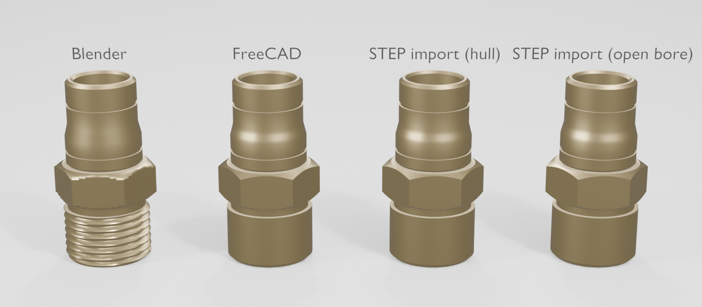
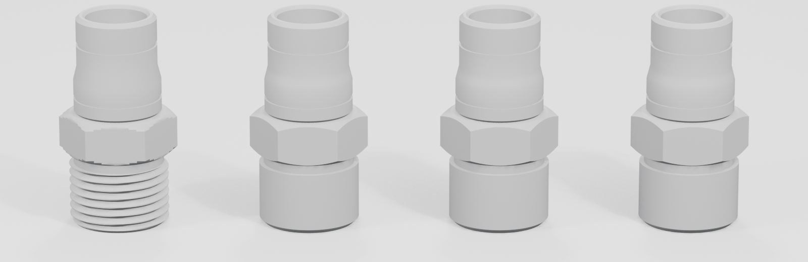
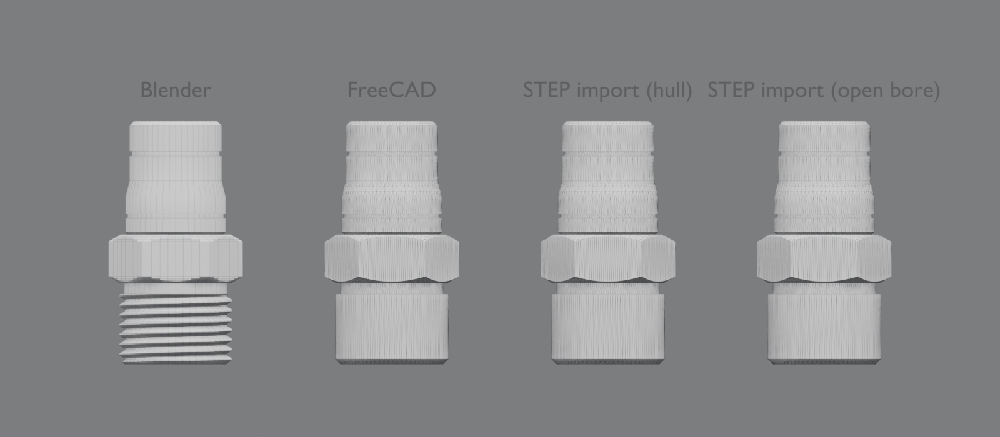

# CAD (FreeCAD) vs. Blender: brass adapter comparison

Measured on 2026-10-28 by `python3 scripts/assets/compare_backends.py`. It is read-only on the asset library: the
**committed** asset files were measured and nothing was regenerated. Raw results are in
`logs/assets/backend_comparison/comparison.json`, and the generated tables in `comparison_tables.md`. Physics comes
from the scene `brass_backend_comparison`: 133/133 targeted checks, plus the workstation's 94/94 static and 39/39
dynamic checks on that derived scene.

| Variant | Asset | Route |
|---|---|---|
| Blender | `brass_adapter_male` | procedural ring mesh from the spec sections (Blender builder) |
| FreeCAD | `brass_adapter_male_cad` | the same sections → FreeCAD solid → STEP + tessellation → Blender preparation → USD |
| STEP import (hull) | `brass_adapter_male_step_import` | that STEP read by FreeCAD → tessellation → Blender; one solid convex-hull collider |
| STEP import (open bore) | `brass_adapter_male_step_import_open` | the same import; open-bore sector colliders from `collision.sections_from` (new in this work) |

All four share the same nominal dimensions (`config/assets/brass_adapter_male.json` and `brass_adapter_male_cad.json`
have identical `outer` / `bore` sections). There is **no manufacturer drawing or physical measurement** of a real
part. "Nominal" below means the spec values, so nothing here proves real-world dimensional accuracy.

## Method

- **Frames and units:** every mesh is read from its visual USD in the asset frame (metres, bottom-centre origin,
  Z axis), so no registration is needed. All variants share that frame, and the bounding boxes agree to 1e-9 m.
- **CAD reference:** the exact B-rep of `brass_adapter_male_cad.step` (FreeCAD: 34 faces, valid, closed, 5932.668 mm³,
  5409.257 mm²).
- **Surface distances:** computed to a 1 µm-chord reference tessellation of that B-rep (65 884 facets).
  - **Sampling:** 20 000 area-weighted random samples per surface, seed 0, in both directions (mesh → CAD and
    CAD → mesh), with nearest-point queries through a BVH.
  - **Proxy error:** 300 samples per mesh were also measured exactly against the B-rep (`Shape.distToShape`). The
    largest difference from the proxy was **3.4 µm**.
  - **Interpretation:** sampled maxima are lower bounds of the true Hausdorff distance, not guaranteed maxima.
- **Feature measurements:** taken from dense barycentric surface samples. Each triangle is classified as outer,
  bore or end face by its normal; sampling triangle interiors matters because CAD tessellations have long triangles.
  - **Hex across flats:** the maximum projection on the six flat normals.
  - **Axial positions:** the exact z of the planar faces.
  - **Tapered sections:** end diameters from a straight-line fit of the radius envelope.

## Quantitative comparison

| Quantity | Nominal | Blender | FreeCAD | STEP import (hull) | STEP import (open bore) |
|---|---|---|---|---|---|
| length (mm) | 45 | 45.0000 | 45.0000 | 45.0000 | 45.0000 |
| max OD = hex corner diameter (mm) | 24.826 | 24.8261 | 24.8261 | 24.8261 | 24.8261 |
| hex across flats, 3 pairs (mm) | 21.500 | 21.5000 | 21.5000 | 21.5000 | 21.5000 |
| hex corner-chamfer length (mm) | 1.270 | 1.270 | 1.270 | 1.270 | 1.270 |
| thread OD, crest / minimum (mm) | 20.96 | 20.960 / **18.720** (helical root) | 20.960 / 20.955 (no helix) | same as FreeCAD | same as FreeCAD |
| cylinder OD max / min (mm), z 24–31 | 18.5 | 18.500 / 18.460 | 18.500 / 18.496 | 18.500 / 18.496 | 18.500 / 18.496 |
| cone end diameters, line fit (mm) | 18.50 → 17.00 | 18.500 → 17.000 | 18.507 → 17.009 | same | same |
| groove depth z 27.5 / z 39.0 (mm) | 0.40 / 0.40 | 0.419 / 0.417 | 0.402 / 0.402 | same | same |
| bore Ø, z 0–24 / z 26–45, min / max (mm) | 16.0 / 13.0 | 15.966 / 16.000, 12.972 / 13.000 | 15.996 / 16.000, 12.997 / 13.000 | same | same |
| chamfer lengths: thread start / nose / bore start / bore end (mm) | 1.0 / 0.8 / 0.6 / 0.6 | **1.126** / 0.800 / 0.600 / 0.600 | 1.000 / 0.800 / 0.600 / 0.600 | same | same |
| planar axial faces at z (mm) | 0, 13, 15, 24, 27.1, 27.9, 38.55, 39.45, 45 | all nine, to 0.01 mm | all nine | all nine | all nine |
| welded vertices / triangles | — | 4320 / 8640 | 4980 / 9960 | 4980 / 9960 | 4980 / 9960 |
| watertight / manifold (boundary / non-manifold edges) | — | yes (0 / 0) | yes (0 / 0) | yes (0 / 0) | yes (0 / 0) |
| mesh volume (mm³) | — | 5490.27 | 5931.37 | 5931.37 | 5931.37 |
| exact CAD solid volume (mm³) | — | — | 5932.668 | 5932.668 (from the STEP) | 5932.668 |
| surface area (mm²) | — | 5804.51 | 5408.85 (B-rep 5409.26) | 5408.85 | 5408.85 |
| mesh → CAD max / mean / p99 (mm) | — | 1.120 / 0.123 / 1.091 | 0.0080 / 0.0012 / 0.0052 | 0.0080 / 0.0012 / 0.0050 | 0.0080 / 0.0012 / 0.0053 |
| CAD → mesh max / mean / p99 (mm) | — | 0.843 / 0.057 / 0.625 | 0.0079 / 0.0012 / 0.0052 | same | same |
| … outside the thread zone (z > 15 mm), mesh → CAD max / mean | — | 0.214 / 0.009 | 0.0080 / 0.0011 | 0.0080 / 0.0010 | 0.0080 / 0.0011 |
| stored mass (g) / density (kg/m³) | — | 45.00 / 8196 (mass_kg target) | 50.25 / 8470 | 50.25 / 8470 | 50.25 / 8470 |
| **controlled** mass at 8470 kg/m³ (g) | — | 46.50 | 50.25 | 50.25 | 50.25 |
| controlled Ixx = Iyy, Izz (kg·m²) | — | 8.242e-6, 3.602e-6 | 9.260e-6, 3.989e-6 | same | same |
| COM height (mm), COM off-axis | — | 21.743, ≤ 5 µm (helix) | 20.656, ~0 | 20.656 | 20.656 |
| colliders | — | 42 convex sector prisms | 42 convex sector prisms | **1 convex hull** | 42 convex sector prisms |
| collider distance from axis / bore | — | 7.10 mm / open | 7.10 mm / open | 0 / **blocked** | 7.10 mm / open |
| settle 3 s, upright on the table: Δz / drift / tilt / force | — | −1.500 mm / 0.000 / 0.005° / = weight | −1.500 / 0.000 / 0.003° / = weight | −1.500 / 0.001 / 0.009° / = weight | −1.500 / 0.000 / 0.004° / = weight |

## What the numbers mean

**A. Accuracy relative to the input specification.** Both builders reproduce every specified dimension:
- length, hex across flats and corner diameter, chamfer lengths, section diameters, axial face positions and bore
  diameters;
- the exact B-rep cone faces confirm the CAD chamfers directly: thread lead-in z 0–1.0, hex chamfers 15.0–16.27 and
  22.73–24.0, nose 44.2–45.0, bore countersinks 0–0.6 and 44.4–45.0.

The remaining differences are representation effects, not dimensional errors:
- **Facet flats:** the Blender minimum diameters (e.g. 18.460 vs 18.5) are the flats of its 48-gon, 0.21 % inside the
  circle. The CAD tessellation's flats are 10× closer (0.004 mm).
- **Groove depths:** 0.419 mm (Blender) and 0.402 mm (CAD) contain the same faceting effect.
- **Thread lead-in:** Blender's 1.126 mm "thread-start chamfer" is the chamfer combined with the helix phase; full
  crest radius is reached where the helix crest passes, slightly after the 1.0 mm chamfer.
- **The genuine geometric difference is the thread.** Blender models a visual helix (crest 20.96, root 18.72 mm).
  FreeCAD models a cosmetic thread, a plain cylinder at the major diameter. That is a modelling choice of the
  FreeCAD builder, not a FreeCAD limitation.

**B. Agreement with the authoritative CAD geometry.**
- **CAD-derived meshes:** they agree with the B-rep to ≤ 8 µm (the spec's 0.01 mm tessellation tolerance) and
  1.2 µm mean.
- **Blender mesh:** it deviates by up to 1.12 mm, almost entirely in the thread zone; the CAD has no helix.
- **Outside the thread:** the Blender mesh still deviates by up to **0.21 mm**, located in the hex corner-chamfer
  zones (z ≈ 15.7–16.3 and 22.8–23.3 mm). Blender evaluates `min(hex, cone)` on 48 angular × 5 axial samples, which
  turns the curved chamfer boundary into steps; this is visible in `03_hex_closeup.png`. FreeCAD intersects the
  chamfer cone with the hex exactly. Everywhere else the Blender mesh is within about 0.01 mm of the CAD (mean
  0.009 mm).

**C. Numerical fidelity after tessellation.**
- The CAD tessellation loses 1.3 mm³ (0.022 %) of the exact volume.
- Mass and inertia on the CAD routes come from the exact solid, cross-checked against the mesh (2.4e-4 inertia
  deviation).
- The Blender route integrates its own closed mesh, which is exact for that mesh.
- At equal density the Blender part is 7.5 % lighter (46.50 vs 50.25 g) and has 11 % lower Ixx. Both differences are
  explained by the cut helical thread grooves that the cosmetic CAD thread does not have.
- The stored masses differ further (45.00 vs 50.25 g) because the Blender spec gives `mass_kg` = 45 g (implied
  8196 kg/m³), while the CAD spec uses 8470 kg/m³ × the exact volume.
- None of these differences is an error. They follow from the different thread assumptions and mass inputs.

**D. Visual similarity to a real fitting.** Not measured; there is no reference object. Judged by eye from the
renders:
- the Blender variant looks more like a real threaded adapter, because its thread is visible;
- the CAD variants show cleaner hex chamfer arcs and finer circular tessellation (no visible 48-gon facets in
  close-up), but a smooth thread band.

## Where FreeCAD measurably helps, and where it does not

| | FreeCAD route | Blender route |
|---|---|---|
| exact solid (B-rep), STEP and `.FCStd` for CAD / manufacturing exchange | **yes** (STEP kept; `.FCStd` for builds from now on) | no |
| exact volume / COM / inertia | **yes**, from the B-rep | from its own mesh (exact for the mesh) |
| intersection geometry (hex chamfer arcs) | **exact** (≤ 8 µm after tessellation) | stepped, up to 0.21 mm |
| circle fidelity at the same budget | adaptive (0.01 mm chord), 15 % more triangles here | fixed 48-gon (0.21 % facet sag) |
| visible helical thread | **no** (cosmetic) | **yes** |
| dimensions vs. the spec | all specified dimensions reproduced | all specified dimensions reproduced |
| tool dependency | FreeCAD 1.1.4 (optional) | Blender only |
| physics in Isaac Sim | equivalent (same collider model, stable settle) | equivalent |

For simulation alone, with the same colliders and stable behaviour, the routes are equivalent. FreeCAD's benefits are
the exact B-rep, the exchange files and exact intersections. The Blender builder's benefit is the visible thread.
Neither is more correct with respect to the real part, because the real part was never measured.

## Collision: open versus blocked bore

- **Same collider model:** the Blender and FreeCAD variants both use the analytic `fitting_sections` colliders. The
  new generation check `colliders_match_mesh` now verifies these colliders against the actual mesh: on the CAD route,
  against the CAD tessellation.
- **Hull import:** the STEP import with `convex_hull` keeps its single solid hull, so its bore is blocked.
- **Open-bore import (new):** `brass_adapter_male_step_import_open` takes its sections explicitly from
  `collision.sections_from: config/assets/brass_adapter_male_cad.json`, the spec that produced the STEP. Generation
  then checks them against the imported mesh: outer excess 0, no mesh beyond the colliders, no collider inside the
  measured bore. It passes, and its bore is open (7.10 mm from the axis versus a narrowest bore radius of 6.5 mm).
- **No guessing:** with the wrong sections (the female adapter's), generation fails (7.5 mm excess, 1.95 mm bore
  intrusion). For an arbitrary STEP without a matching fitting spec there is no automatic bore-preserving collider;
  only `primitive` / `convex_hull` are available, as documented.

## Images

All renders are at the same scale, orientation and lighting. Left to right: Blender, FreeCAD, STEP import (hull),
STEP import (open bore).

| File | Content |
|---|---|
| `docs/images/cad_comparison/01_overall_brass.png` | brass material, labelled |
| `02_neutral_geometry_front.png` | neutral grey, orthographic front view, labelled |
| `03_hex_closeup.png` | hex sections: stepped Blender chamfer edge vs. exact CAD arcs |
| `04_bore_and_top_chamfer.png` | top view into the bores and the nose / bore chamfers |
| `05_thread_end_and_bottom_chamfer.png` | thread end: visible helix vs. cosmetic thread, lead-in chamfer |
| `06_wireframe_tessellation.png`, `07_wireframe_hex_closeup.png` | tessellation: 48-gon rings vs. adaptive CAD triangles |
| `logs/assets/brass_backend_comparison/base_suites/preview_backend_overview.png` | the same four in Isaac Sim (RTX real-time), labelled, on the workstation table |





## Limitations

- No real-world reference (drawing, measurement or manufacturer CAD); "accuracy" here is relative to the spec and to
  this project's own CAD.
- Distances are sampled: 20 000 samples per direction, with a reference proxy error ≤ 3.4 µm (measured on 300
  points).
- The thread zone dominates the Blender deviations by design. Statistics outside the thread zone (z > 15 mm) are
  reported separately.
- One part family (Type A adapter) only. The FreeCAD builder exists only for `fitting`.
- `brass_adapter_male_cad` predates `.FCStd` export; it keeps its STEP. It was not rebuilt, so the validated files
  stay unchanged.

## Reproduce

```bash
scripts/assets/build_backend_comparison.sh       # scene + 133 targeted checks + workstation suites + Isaac overview (Blender, Isaac)
python3 scripts/assets/compare_backends.py       # measurements + renders (Blender, FreeCAD); read-only on the library
"$ISAACSIM_PYTHON" scripts/workstation/open_scene.py --scene assets/scenes/derived/brass_backend_comparison.usda
```
