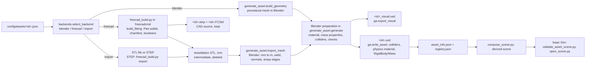

# Geometry backends: Blender, FreeCAD, CAD import

Every library asset is built by one **geometry backend**. The backend is chosen deterministically from the asset spec
and the installed tools (`scripts/assets/backends.py`).
- **FreeCAD** is the CAD geometry-authoring backend: it is the authoritative source for CAD assets and produces STEP
  and `.FCStd`.
- **Blender** is the shared mesh-preparation and USD-export stage for every route. On the CAD routes it consumes the
  actual FreeCAD tessellation; it does not remodel the shape.
- **Isaac Sim** validates the result.
- **Blender-only generation** stays the default, and FreeCAD is optional.



## Execution path of the FreeCAD route (function level)

| Step | Where | What |
|---|---|---|
| 1 | `generate_asset.generate` → `backends.select_backend` | decision + rule + reason, e.g. rule 3: auto + engineering/STEP + builder + FreeCAD installed |
| 2 | `generate_asset.run_freecad("build")` → `backends.find_freecad` / `freecad_command` | starts `<FreeCAD> [freecadcmd] scripts/assets/freecad_build.py` with `FCB_*` environment variables |
| 3 | `freecad_build.build_fitting` (`round_section`, `hex_section`, `bore_solid`) | the parametric solid from the spec sections (read through `asset_lib.fitting_sections`) |
| 4 | `freecad_build.export` / `save_native` | `<id>.step` (`exportStep`, round-trip checked), `<id>.stl` (`MeshPart.meshFromShape`, watertight and volume checked), `<id>.FCStd` (Part::Feature + the spec JSON); result JSON with exact volume / COM / inertia |
| 5 | `generate_asset.import_mesh` | Blender imports the STL (`bpy.ops.wm.stl_import`, scale 0.001: mm → m; the CAD frame is already the asset frame, bottom centre, Z up), welds, recalculates normals, sharpens edges > 30° |
| 6 | `generate_asset.generate` | visual material (`ga.material`); mass / COM / inertia from the exact solid, cross-checked against the mesh (`cad_mesh_mass_consistency`) |
| 7 | `generate_asset.colliders_for` → `asset_lib.collider_pieces` | analytic colliders (`fitting_sections`), verified against the imported CAD mesh by `colliders_match_mesh` |
| 8 | `ga.export_visual` / `ga.write_asset` / `set_contact_offset` / `usd_checks` | `<id>_visual.usd` (Blender USD export) and `<id>.usd` (colliders, physics material, RigidBodyAPI + MassAPI) |
| 9 | `generate_asset.generate` → `asset_lib.rebuild_registry` | `asset_info.json` (`geometry_backend`, `cad`, checks, file hashes incl. STEP / FCStd) and `registry.json` |
| 10 | `compose_scene.py`, `validate_asset_scene.py`, `open_scene.py` | unchanged for every route |

The STL is only a transport format between FreeCAD and Blender and is deleted. The kept representations are separate:

| Representation | File | Made by | Used for |
|---|---|---|---|
| CAD source | `<id>.step`, `<id>.FCStd` (FreeCAD route) or the referenced source STEP (import) | FreeCAD | engineering exchange, exact properties, comparison reference |
| visual mesh | `<id>_visual.usd` | Blender (from the CAD tessellation or its own builder) | rendering |
| collision geometry | `Collision/*` in `<id>.usd` | `asset_lib.collider_pieces` (analytic, simplified), checked against the visual mesh | PhysX |

## Spec fields (`geometry`)

| Field | Values | Meaning |
|---|---|---|
| `backend` | `blender` (default when absent), `auto`, `freecad`, `import` | absent means `blender`, so every spec written before backends existed keeps its validated route |
| `accuracy` | `visual` (default), `engineering` | input to `auto` |
| `require_step` | bool | a STEP file must exist at the end (FreeCAD builder or STEP source); otherwise the spec / selection fails |
| `cad` | `{linear_deflection_mm (0.01), angular_deflection_deg (5)}` | FreeCAD tessellation of the solid for the visual mesh |
| `collision.sections_from` (mesh_import + `fitting_sections`) | a fitting spec path | open-bore colliders for an imported turned part, from the sections of the spec that describes it; generation fails unless they match the imported mesh (`colliders_match_mesh`) |
| method `mesh_import` | `source` (project-relative `.stl` / `.step` / `.stp`), `size` (expected envelope, m), `source_units` (`mm` default / `m`), `recenter` (default true) | an existing model |

The geometry parameters are **not** duplicated per backend: the FreeCAD fitting builder reads the same `outer` /
`bore` sections, through `asset_lib.fitting_sections`, as the Blender builder.

## Capabilities (what is actually implemented)

| Method | blender | freecad | import |
|---|---|---|---|
| `box`, `cylinder`, `tube`, `open_container`, `label_plate` | yes | **no builder** | — |
| `fitting` (stepped turned parts, hex, chamfers, grooves, bore, threads) | yes (visual helical threads) | yes (cosmetic threads) | — |
| `mesh_import` | — | — | STL (Blender), STEP (FreeCAD → STL); colliders `primitive` / `convex_hull` (solid), or `fitting_sections` with `sections_from` (open bore, verified) |

FreeCAD fitting builder (`freecad_build.py`, all solids made with real FreeCAD operations):

| Feature | CAD operation |
|---|---|
| cylinder / cone sections | `Part.makeCylinder` / `Part.makeCone` |
| section chamfers | `Shape.makeChamfer` on the actual circular end edge |
| grooves | boolean cut of a ring |
| hex section | extruded hexagon (`Face.extrude`) ∩ two 30° chamfer cones (`common`) |
| bore | revolved (r, z) profile (`Face.revolve`, 360°) with countersink chamfers, removed with a boolean cut |
| assembly | `multiFuse` + `removeSplitter`, then validity / single closed solid checks |
| threads | **cosmetic only**: plain cylinder at the major (outer) / minor (bore) diameter. The helix is not modelled, so a CAD part has more volume and mass than the Blender part with cut threads. |
| fillets | the API works (`makeFillet`, probed on FreeCAD 1.1.4), but no spec field uses it yet |

Not supported, and rejected with a validation error rather than replaced by another shape:
- FreeCAD builders for containers, labels, boxes and tubes;
- STEP output from the Blender route;
- `require_step` with an STL source;
- open-bore colliders for an imported mesh without a matching fitting spec: there is no automatic bore detection or
  convex decomposition.

## Selection rules (`backends.select_backend`, first match wins)

1. **Explicit backend:** that backend; it fails if its tool is missing.
2. **`auto` + `mesh_import`:** `import` (an existing model is preferred).
3. **`auto` + (`require_step` or `accuracy: engineering`):** `freecad`, if a FreeCAD builder exists for the method
   and FreeCAD is installed.
4. **`auto` + `require_step`, when rule 3 is impossible:** an error. The STEP requirement is never dropped silently.
5. **`auto` + `engineering`, CAD route unavailable:** `blender`, with the reason recorded.
6. **`auto`, otherwise:** `blender`.

- **Category:** the asset category is not an input. An "industrial" label does not make an asset CAD.
- **Determinism:** the decision depends only on the spec and on the tool configuration (`backends.tools()`).
- **Recording:** the decision, the rule and the reason go to `asset_info.json` → `geometry_backend`, and the backend
  to `registry.json`.
- **Commands:**
  - `python3 scripts/assets/backends.py select <spec>` prints the decision without building anything.
  - `python3 scripts/assets/backends.py tools` shows the detected tools.

## FreeCAD invocation

- **Discovery** (`backends.find_freecad`; it only checks files and never runs FreeCAD):
  `$FREECAD_EXECUTABLE` → `freecadcmd` / `FreeCADCmd` on `PATH` → the newest `~/Applications/FreeCAD*.AppImage`.
- **Command:**
  - AppImage: `<AppImage> freecadcmd freecad_build.py`;
  - console binary: `freecadcmd freecad_build.py`.
- **Inputs:** environment variables (`FCB_MODE`, `FCB_SPEC`, `FCB_SOURCE`, `FCB_OUT_DIR`, `FCB_RESULT`), because
  `freecadcmd` treats extra arguments as files to open. Blender's `PYTHONPATH` / `PYTHONHOME` / `LD_LIBRARY_PATH`
  are removed.
- **Result:** a JSON file whose `ok` field is authoritative, because `freecadcmd`'s exit code is not reliable.
- **Log:** `logs/assets/library/<id>/freecad.log` (git-ignored).
- **Do not run `<AppImage> --version`:** it starts the FreeCAD GUI. `scripts/check_environment.sh` reads the version
  through `freecadcmd` instead.
- **Tested:** FreeCAD 1.1.4 AppImage (Python 3.11) on Ubuntu 22.04.

## Checks on the CAD routes

- **In FreeCAD (`cad.checks`):**
  - a valid, closed single solid;
  - the tight bounding box (`optimalBoundingBox`; `BoundBox` is loose on cones) matches the spec envelope;
  - the STEP round trip keeps the volume (1e-6);
  - the tessellation is watertight and its volume is within 0.5 % of the solid.
- **In Blender, the usual checks plus:**
  - the mesh volume against the exact solid volume (2e-3);
  - `cad_mesh_mass_consistency`: mass, COM and inertia are taken from the exact solid and must agree with the mesh
    integral (within 1 % / 0.1 mm);
  - `cad_solid`.
- **Staleness:** an imported asset becomes `stale` when its source file changes (`import_source.sha256`).
- **`colliders_match_mesh` (every `fitting_sections` asset generated from now on):** a zone-by-zone check of the
  analytic colliders against the actual visual mesh, which is the CAD tessellation on the CAD routes.
  - **Method:** triangles are classified as outer or bore by their normals, and points are sampled across each
    triangle.
  - **Criteria:** outer excess ≤ dimension tolerance; no mesh beyond the collider's outer vertices; no collider
    inside the measured bore.
  - **Proof it works:** a negative test with the wrong part's sections fails (7.5 mm excess, 1.95 mm bore
    intrusion).
- **`.FCStd`:** saved by every FreeCAD build from now on (`fcstd_saved`).

## Demonstration and comparison

| Asset | Route | Result |
|---|---|---|
| `brass_adapter_male` | A, Blender (unchanged; spec has no `backend`) | rebuilt to check (2026-10-28): physics and visual USD byte-identical to the committed files (then restored) |
| `brass_adapter_male_cad` | B: `auto` + `engineering` + `require_step` → `freecad` (rule 3) | 34-face solid, 5932.668 mm³; STEP round trip exact; 9960 facets; mass 50.25 g at 8470 kg/m³ (built before `.FCStd` export existed; not rebuilt) |
| `brass_adapter_male_step_import` | C: `auto` + `mesh_import` of the STEP above → `import` | identical solid, mass and inertia; one solid convex-hull collider (bore blocked) |
| `brass_adapter_male_step_import_open` | C with `collision.sections_from` | 42 open-bore sector colliders; `colliders_match_mesh` passed |

The full engineering comparison of all four is in [CAD_VS_BLENDER_COMPARISON.md](CAD_VS_BLENDER_COMPARISON.md): every
specified dimension is reproduced by both builders; CAD meshes are within 8 µm of the B-rep; the Blender mesh differs
in the thread (visual helix vs. cosmetic) and by up to 0.21 mm in the hex corner chamfers. To reproduce it:
```bash
scripts/assets/build_backend_comparison.sh   # side-by-side scene, 133 targeted checks, workstation suites, Isaac overview
python3 scripts/assets/compare_backends.py    # measurements (comparison.json / comparison_tables.md) + renders
```

## Creating a new FreeCAD asset (existing builder)

1. Write a `fitting` spec with `"backend": "auto"`, plus `"accuracy": "engineering"` and/or `"require_step": true`
   (or `"backend": "freecad"`). Use `config/assets/brass_adapter_male_cad.json` as a template.
2. `python3 scripts/assets/backends.py select config/assets/<id>.json` must report `freecad`.
3. `"$BLENDER" -b --factory-startup --python-exit-code 1 --python scripts/assets/generate_asset.py -- --spec config/assets/<id>.json`
   writes `assets/library/<id>/` (`.usd`, `_visual.usd`, `.step`, `.FCStd`, `asset_info.json`).
4. Add it to a scene (`asset_lib.py add-instance …`) and run `add_asset.py --spec … --scene …`, which composes and
   validates in Isaac Sim.

## Adding a FreeCAD builder

1. Write `build_<method>(spec)` in `freecad_build.py` with real solids (`Part.*`, booleans, `makeChamfer` /
   `makeFillet`), reading the spec through `asset_lib` helpers, so the Blender and FreeCAD builders share one source
   of parameters.
2. Dispatch it in `main()` and add the method to `backends.FREECAD_METHODS`, with a feature row in
   `FREECAD_FITTING_FEATURES`, or a sibling table.
3. Make sure `asset_lib.nominal_size` / `collider_pieces` cover the method. Colliders stay analytic and do not come
   from the CAD mesh.
4. Add selftest cases (selection and spec errors), a spec with `backend: auto`, and run `generate_asset.py` and the
   targeted validator on a scene.
