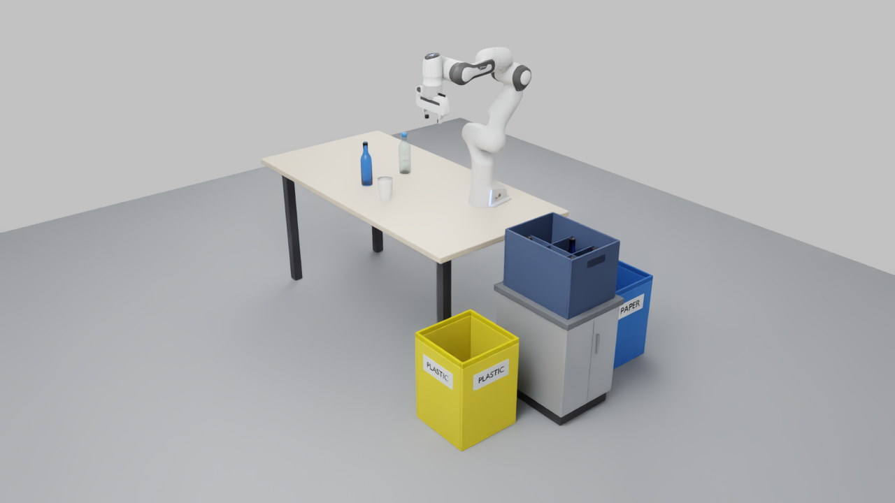
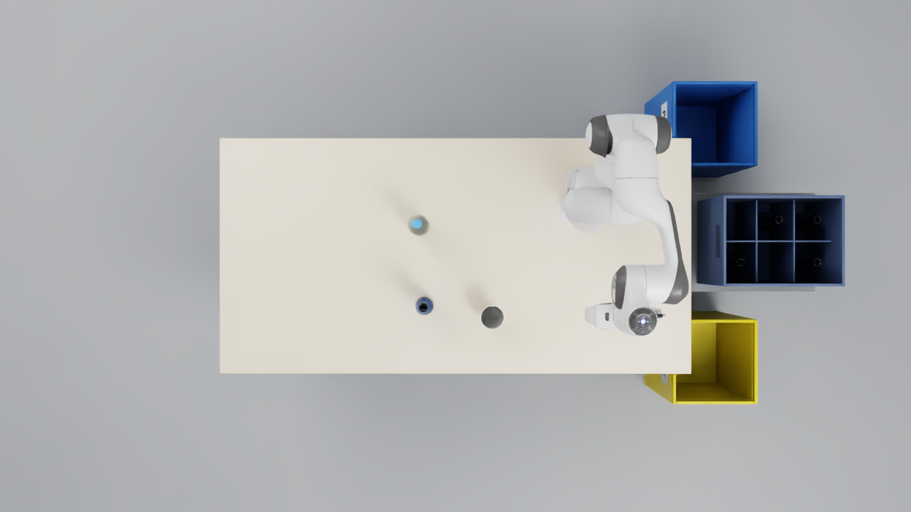
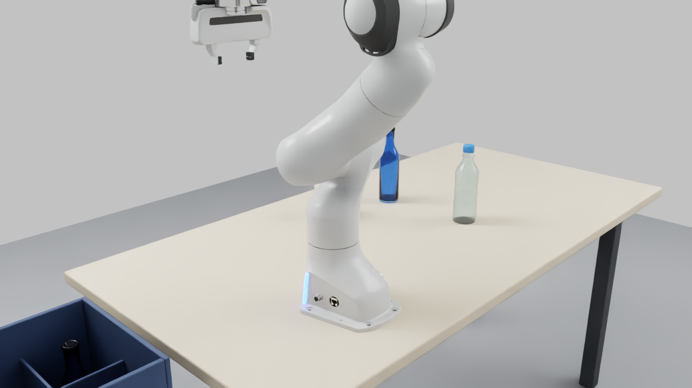

# Waste-sorting workstation — validation report

- Generated: 2026-10-27T17:36:37+01:00
- **Classification: FULLY VALIDATED**
- Static checks: 94/94; dynamic checks: 39/39
- Scene: `assets/scenes/waste_sorting_workstation.usd`; config: `config/waste_sorting_environment.json`
- Robot: official NVIDIA Franka Emika Panda (`Isaac/Robots/FrankaRobotics/FrankaPanda/franka.usd`, variants {'Gripper': 'Default', 'Mesh': 'Performance'}), resolved to `https://omniverse-content-production.s3-us-west-2.amazonaws.com/Assets/Isaac/6.2/Isaac/Robots/FrankaRobotics/FrankaPanda/franka.usd`

## Success criteria

| Criterion | Met |
|---|---|
| 1_complete_usd_scene | yes |
| 2_real_articulated_robot | yes |
| 3_table_four_legs | yes |
| 4_three_objects | yes |
| 5_two_bins | yes |
| 6_glass_crate | yes |
| 7_visual_materials | yes |
| 8_physics_configured | yes |
| 9_objects_settle | yes |
| 10_bins_functional_collision | yes |
| 11_scene_opens_in_isaac_sim | yes |
| 12_main_camera_complete_view | yes |
| 13_validation_saved | yes |
| 14_ramp_project_functional | yes |
| 15_sorting_zone_layout_valid | yes |
| 16_destination_targets_ik_and_endpoint_clear | yes |
| 17_glass_placement_stable | yes |

## Executed stages

| Stage | Exit | Time (s) | Log |
|---|---|---|---|
| generate_assets (Blender) | 0 | 2.0 | `logs/workstation/assets_generate.log` |
| build_scene | 0 | 10.4 | `logs/workstation/build.log` |
| validate_scene | 0 | 31.3 | `logs/workstation/validate.log` |
| run_physics_test | 0 | 15.8 | `logs/workstation/physics.log` |
| render_previews | 0 | 25.6 | `logs/workstation/render.log` |
| ramp regression: asset pipeline (sandbox) | 0 | 3.5 | `logs/workstation/ramp_regression.log` |
| ramp regression: Isaac Sim friction test (sandbox) | 0 | 15.5 | `logs/workstation/ramp_regression_isaac.log` |

## Scene layout (world frame, metres; Z up)

- Table: 1.6 × 0.8 × 0.75 m centred at [0.0, 0.0]; top surface z = 0.75, bottom z = 0.72; 4 legs 0.05×0.05×0.72 m, outer faces inset 0.08 m from the tabletop edges.
- Robot base (panda_link0 frame): [0.45, 0.15, 0.75], yaw -90.0°; home pose [0.0, -45.0, 0.0, -135.0, 0.0, 90.0, 45.0]° , fingers [0.04, 0.04] m.
- glass_bottle: initial (bottom-centre) [-0.1, -0.16, 0.7515], mass 0.3 kg
- plastic_bottle: initial (bottom-centre) [-0.12, 0.1, 0.7515], mass 0.025 kg
- paper_cup: initial (bottom-centre) [0.12, -0.2, 0.7515], mass 0.012 kg
- paper_bin: centre [0.98, 0.5, 0.0], 0.32 × 0.32 × 0.45 m, label PAPER
- plastic_bin: centre [0.98, -0.4, 0.0], 0.32 × 0.32 × 0.45 m, label PLASTIC
- Glass crate (on the platform): base [1.08, 0.05, 0.55], yaw 0°, 0.4 × 0.3 × 0.28 m, 4 static bottles
- Ground: [5.0, 5.0] m slab, top at z = 0.

Robot mounting and tabletop objects are unchanged from the first validated layout; the sorting destinations were re-positioned by optimize_layout.py (see the sorting-zone section).

## Assets

| Asset | Files | Collision | Mass properties |
|---|---|---|---|
| table | table.usd, tabletop.usd, table_leg.usd, tabletop_visual.usd, table_leg_visual.usd | None | static |
| glass_bottle | glass_bottle.usd, glass_bottle_visual.usd | [Body, Shoulder, Neck] | COM z=0.08823 m, I=[0.001424, 0.001424, 0.0001899] kg·m², mesh volume 0.0001191 m³ → density 2519 kg/m³ |
| plastic_bottle | plastic_bottle.usd, plastic_bottle_visual.usd | [Body, Shoulder, Neck, Cap] | COM z=0.09726 m, I=[0.0001413, 0.0001413, 1.873e-05] kg·m² |
| paper_cup | paper_cup.usd, paper_cup_visual.usd | 17 | COM z=0.05338 m, I=[2.205e-05, 2.205e-05, 1.261e-05] kg·m², mesh volume 2.867e-05 m³ → density 418.6 kg/m³ |
| paper_bin | paper_bin.usd, paper_bin_visual.usd | [Bottom, WallPosX, WallNegX, WallPosY, WallNegY] | static |
| plastic_bin | plastic_bin.usd, plastic_bin_visual.usd | [Bottom, WallPosX, WallNegX, WallPosY, WallNegY] | static |
| glass_crate | glass_crate.usd, glass_crate_visual.usd | [Bottom, WallPosX, WallNegX, WallPosY, WallNegY, SeparatorX1, SeparatorX2, SeparatorY1] | static |
| crate_platform | crate_platform.usd, crate_platform_visual.usd | [Kick, Body, Top] | static |

## Static validation (geometry, USD, physics schemas, robot)

| Group | Check | Result | Key values |
|---|---|---|---|
| usd | `scene_opens` | PASS | path=assets/scenes/waste_sorting_workstation.usd |
| usd | `no_composition_errors` | PASS | errors=[] |
| usd | `all_references_resolve` | PASS | unresolved=[]; layers=59 |
| usd | `units` | PASS | meters_per_unit=1; up_axis=Z; kilograms_per_unit=1 |
| usd | `default_prim` | PASS | default_prim=/World |
| usd | `hierarchy_complete` | PASS | missing=[] |
| usd | `visual_material_bindings_resolve` | PASS | render_gprims=61; unbound=[] |
| usd | `physics_material_bindings_resolve` | PASS | colliders=63; unbound=[] |
| geometry | `table_overall_dimensions` | PASS | actual=[1.6, 0.8, 0.75]; expected=[1.6, 0.8, 0.75] |
| geometry | `table_rests_on_ground` | PASS | table_min_z=0 |
| geometry | `tabletop_surfaces` | PASS | top_z=0.75; bottom_z=0.72; collider_size=[1.6, 0.8, 0.03] |
| geometry | `exactly_four_legs` | PASS | count=4 |
| geometry | `leg_dimensions_and_contact` | PASS |  |
| geometry | `leg_inset_from_edges` | PASS | outer_face_insets=[0.08, 0.08, 0.08, 0.08]; expected=0.08; reference=leg_outer_face |
| geometry | `legs_do_not_penetrate_tabletop` | PASS | overlap_depths=[1.397e-08, 1.397e-08, 1.397e-08, 1.397e-08]; note=0 = touching |
| geometry | `glass_bottle_dimensions` | PASS | size=[0.06, 0.06, 0.23]; expected_height=0.23; expected_max_diameter=0.06 |
| geometry | `glass_bottle_position` | PASS | centre_xy=[-0.1, -0.16]; expected_xy=[-0.1, -0.16]; collider_bottom_z=0.7515; expected_bottom_z=0.7515 |
| geometry | `glass_bottle_upright` | PASS | tilt_deg=0 |
| geometry | `glass_bottle_not_penetrating_tabletop` | PASS | gap_m=0.0015 |
| geometry | `glass_bottle_footprint_on_tabletop` | PASS | collider_xy=[[-0.13, -0.19], [-0.07, -0.13]] |
| geometry | `plastic_bottle_dimensions` | PASS | size=[0.065, 0.065, 0.22]; expected_height=0.22; expected_max_diameter=0.065 |
| geometry | `plastic_bottle_position` | PASS | centre_xy=[-0.12, 0.1]; expected_xy=[-0.12, 0.1]; collider_bottom_z=0.7515; expected_bottom_z=0.7515 |
| geometry | `plastic_bottle_upright` | PASS | tilt_deg=0 |
| geometry | `plastic_bottle_not_penetrating_tabletop` | PASS | gap_m=0.0015 |
| geometry | `plastic_bottle_footprint_on_tabletop` | PASS | collider_xy=[[-0.1525, 0.0675], [-0.0875, 0.1325]] |
| geometry | `paper_cup_dimensions` | PASS | size=[0.08, 0.08, 0.11]; expected_height=0.11; expected_max_diameter=0.08 |
| geometry | `paper_cup_position` | PASS | centre_xy=[0.12, -0.2]; expected_xy=[0.12, -0.2]; collider_bottom_z=0.7514; expected_bottom_z=0.7515 |
| geometry | `paper_cup_upright` | PASS | tilt_deg=0 |
| geometry | `paper_cup_not_penetrating_tabletop` | PASS | gap_m=0.001387 |
| geometry | `paper_cup_footprint_on_tabletop` | PASS | collider_xy=[[0.07983, -0.2402], [0.1602, -0.1598]] |
| geometry | `objects_separated` | PASS | minimum=0.02 |
| geometry | `paper_bin_dimensions` | PASS | size=[0.32, 0.32, 0.45]; expected=[0.32, 0.32, 0.45] |
| geometry | `paper_bin_on_floor_at_position` | PASS | min_z=-5.215e-11; centre_xy=[0.98, 0.5] |
| geometry | `plastic_bin_dimensions` | PASS | size=[0.32, 0.32, 0.45]; expected=[0.32, 0.32, 0.45] |
| geometry | `plastic_bin_on_floor_at_position` | PASS | min_z=-5.215e-11; centre_xy=[0.98, -0.4] |
| geometry | `crate_dimensions` | PASS | size=[0.4, 0.3, 0.28]; expected_sorted_xy_then_h=[0.3, 0.4, 0.28] |
| geometry | `crate_on_support` | PASS | min_z=0.55; support=crate_platform; support_top_z=0.55 |
| geometry | `crate_bottles_inside_crate` | PASS | count=4; inside=[True, True, True, True] |
| geometry | `no_static_intersections` | PASS | near_or_overlapping={}; note=AABB overlap depth; values > 0 overlap, -0.005..0 are within 5 mm |
| geometry | `within_ground_bounds` | PASS | ground=[[-2.5, -2.5, -0.02], [2.5, 2.5, -2.235e-10]] |
| physics | `physics_scene_exists` | PASS | scenes=[/World/PhysicsScene] |
| physics | `gravity_and_rate` | PASS | direction=[0, 0, -1]; magnitude=9.81; steps_per_second=120; gpu_dynamics=False |
| physics | `table_static_collider` | PASS | colliders=5; rigid_bodies=[] |
| physics | `paper_bin_static_collider` | PASS | colliders=5; rigid_bodies=[] |
| physics | `plastic_bin_static_collider` | PASS | colliders=5; rigid_bodies=[] |
| physics | `crate_static_collider` | PASS | colliders=8; rigid_bodies=[] |
| physics | `crate_platform_static_collider` | PASS | colliders=3; rigid_bodies=[] |
| physics | `ground_static_collider` | PASS | colliders=1; rigid_bodies=[] |
| physics | `paper_bin_open_top_compound` | PASS | colliders=[Bottom, WallNegX, WallNegY, WallPosX, WallPosY]; colliders_intruding_interior_or_opening=[]; opening_m=[0.296, 0.296] |
| physics | `plastic_bin_open_top_compound` | PASS | colliders=[Bottom, WallNegX, WallNegY, WallPosX, WallPosY]; colliders_intruding_interior_or_opening=[]; opening_m=[0.296, 0.296] |
| physics | `crate_open_top` | PASS | horizontal_colliders_at_top=[] |
| physics | `glass_bottle_dynamic_body` | PASS | mass=0.3; diagonal_inertia=[0.001424, 0.001424, 0.0001899]; center_of_mass=[8.04e-19, -4.033e-18, 0.08823]; colliders=3 |
| physics | `plastic_bottle_dynamic_body` | PASS | mass=0.025; diagonal_inertia=[0.0001413, 0.0001413, 1.873e-05]; center_of_mass=[-3.36e-18, -1.241e-17, 0.09726]; colliders=4 |
| physics | `paper_cup_dynamic_body` | PASS | mass=0.012; diagonal_inertia=[2.205e-05, 2.205e-05, 1.261e-05]; center_of_mass=[3.571e-18, -4.087e-18, 0.05338]; colliders=17 |
| physics | `crate_bottles_static` | PASS | static=4; total=4 |
| robot | `reference_resolves` | PASS | variants={'Mesh': 'Performance', 'Gripper': 'Default'} |
| robot | `single_articulation_root` | PASS | articulation_roots=[/World/RobotMount/Robot] |
| robot | `joint_definitions` | PASS | revolute=[panda_joint1, panda_joint2, panda_joint3, panda_joint4, panda_joint5, panda_joint6, panda_joint7]; prismatic=[panda_finger_joint1, panda_finger_joint2] |
| robot | `base_fixed_to_world` | PASS | world_joints=[/World/RobotMount/Robot/rootJoint]; note=rootJoint: body0 = panda_link0, body1 = world |
| robot | `gripper_exists` | PASS | links=[panda_hand, panda_leftfinger, panda_rightfinger] |
| robot | `robot_physics_valid` | PASS | rigid_bodies=11; colliders=11 |
| robot | `no_extra_robot_physics_schemas` | PASS | scene_added_schemas=[PhysicsFilteredPairsAPI, PhysicsJointStateAPI:angular, PhysicsJointStateAPI:linear]; allowed=[PhysicsFilteredPairsAPI, PhysicsJointStateAPI:angular, PhysicsJointStateAPI:linear] |
| robot | `home_pose_within_limits` | PASS |  |
| robot | `base_on_tabletop` | PASS | base_min_z=0.75; base_frame_origin=[0.45, 0.15, 0.75]; configured=[0.45, 0.15, 0.75]; note=base frame = panda_link0 origin; its visual casting is not centred on the frame |
| robot | `base_footprint_on_tabletop` | PASS | base_bounds=[[0.3554, 0.07846, 0.75], [0.5446, 0.3041, 0.89]] |
| robot | `base_tabletop_contact_filtered` | PASS | filtered_pairs=[/World/Workstation/Table/Tabletop/Collision/TopSlab/Shape] |
| robot | `objects_clear_of_robot_base` | PASS | aabb_overlap={'glass_bottle': -0.4254040462805917, 'plastic_bottle': -0.4429040468021323, 'paper_cup': -0.23828123218893837} |
| layout | `analytic_model_matches_usd_colliders` | PASS | boxes=26; max_aabb_difference_m=1.431e-08; missing_in_usd=[] |
| layout | `platform_static_collider` | PASS | colliders=[platform/Kick, platform/Body, platform/Top]; rigid_bodies=[] |
| layout | `platform_stable_base` | PASS | on_floor_min_z=6.706e-10; height_m=0.55; narrowest_base_m=0.306; height_to_base_ratio=1.797; note=static collider; ratio <= 3 for a visually/physically plausible stand |
| layout | `crate_supported_by_platform` | PASS | crate_bottom_z=0.55; platform_top_z=0.55; crate_footprint_within_top=True; top_margin_m=[0.03, 0.03, 0.03, 0.03] |
| layout | `destinations_at_configured_positions` | PASS | centre_errors_m={'paper_bin': 0.0, 'plastic_bin': 0.0, 'crate_platform': 1.3877787807814457e-17}; positions={'paper_bin': [0.98, 0.5], 'plastic_bin': [0.98, -0.4], 'crate_platform': [1.08, 0.05]}; crate_on_platform_at=[1.08, 0.05, 0.55] |
| layout | `no_destination_intersections` | PASS | minimum_m=0.03 |
| layout | `empty_compartment_available` | PASS | empty=[[0, 1], [1, 0]]; target=[1, 0] |
| layout | `glass_bottle_fits_target_compartment` | PASS | free_size_m=[0.1207, 0.137]; bottle_diameter_m=0.06; radial_clearance_m=[0.03033, 0.0385]; bottle_height_m=0.23; compartment_depth_to_rim_m=0.27; separator_height_m=0.2 |
| layout | `paper_bin_opening_unobstructed` | PASS | obstacles_above_opening=[]; opening_half_m=0.1479 |
| layout | `plastic_bin_opening_unobstructed` | PASS | obstacles_above_opening=[]; opening_half_m=0.1479 |

## Dynamic validation (headless PhysX, CPU, 120 Hz)

| Group | Check | Result | Key values |
|---|---|---|---|
| settle_glass_bottle | `no_fall_through_tabletop` | PASS | max_penetration_mm=0; tolerance_mm=3 |
| settle_glass_bottle | `settled_on_tabletop` | PASS | final_bottom_gap_mm=0; height_change_mm=-0.062 |
| settle_glass_bottle | `remains_upright` | PASS | max_tilt_deg=0.0021 |
| settle_glass_bottle | `no_horizontal_drift` | PASS | drift_mm=0.001 |
| settle_glass_bottle | `at_rest` | PASS | mean_speed_last_0_5s=4.70e-06 |
| settle_glass_bottle | `supported_by_tabletop_force` | PASS | normal_force_N=2.943; weight_N=2.943 |
| settle_plastic_bottle | `no_fall_through_tabletop` | PASS | max_penetration_mm=0.001; tolerance_mm=3 |
| settle_plastic_bottle | `settled_on_tabletop` | PASS | final_bottom_gap_mm=-0.001; height_change_mm=-0.083 |
| settle_plastic_bottle | `remains_upright` | PASS | max_tilt_deg=0.002 |
| settle_plastic_bottle | `no_horizontal_drift` | PASS | drift_mm=0.002 |
| settle_plastic_bottle | `at_rest` | PASS | mean_speed_last_0_5s=1.58e-04 |
| settle_plastic_bottle | `supported_by_tabletop_force` | PASS | normal_force_N=0.2453; weight_N=0.2453 |
| settle_paper_cup | `no_fall_through_tabletop` | PASS | max_penetration_mm=0; tolerance_mm=3 |
| settle_paper_cup | `settled_on_tabletop` | PASS | final_bottom_gap_mm=0.113; height_change_mm=-0.036 |
| settle_paper_cup | `remains_upright` | PASS | max_tilt_deg=0.0002 |
| settle_paper_cup | `no_horizontal_drift` | PASS | drift_mm=0 |
| settle_paper_cup | `at_rest` | PASS | mean_speed_last_0_5s=1.24e-05 |
| settle_paper_cup | `supported_by_tabletop_force` | PASS | normal_force_N=0.1177; weight_N=0.1177 |
| robot | `articulation_initialized` | PASS | num_dofs=9 |
| robot | `initial_state_is_home_pose` | PASS | initial_deg=[-0, -45, 0, -135, -0, 90, 45] |
| robot | `stable_holding_home_pose` | PASS | max_joint_drift_deg=0.0613; max_finger_drift_m=0 |
| robot | `base_fixed` | PASS | base_drift_m=0.00e+00; base_position=[0.45, 0.15, 0.75] |
| robot | `no_initial_collision_with_table_or_objects` | PASS | max_link_table_force_N=0; max_link_object_force_N=0; base_table_force_N_filtered=0 |
| robot | `link_contact_readback_positive_control` | PASS | links_with_contact={'panda_link5': 0.514440655708313}; note=probe dropped onto the fixed robot in the temporary stage; proves the link contact view reports real contacts |
| bin_drop_paper_bin | `enters_through_open_top` | PASS | xy_at_rim=[1.01, 0.48]; opening_half_m=0.148 |
| bin_drop_paper_bin | `falls_inside` | PASS | final_top_z=0.072; rim_z=0.45 |
| bin_drop_paper_bin | `collides_with_bottom` | PASS | rest_bottom_z=0.012; floor_top_z=0.012; bottom_contact_force_N=0.981; weight_N=0.981 |
| bin_drop_paper_bin | `no_pass_through_bottom` | PASS | min_cube_bottom_z=0.012; floor_top_z=0.012 |
| bin_drop_paper_bin | `remains_contained` | PASS | final=[1.01, 0.48, 0.042]; final_speed=7.16e-06 |
| bin_drop_plastic_bin | `enters_through_open_top` | PASS | xy_at_rim=[1.01, -0.42]; opening_half_m=0.148 |
| bin_drop_plastic_bin | `falls_inside` | PASS | final_top_z=0.072; rim_z=0.45 |
| bin_drop_plastic_bin | `collides_with_bottom` | PASS | rest_bottom_z=0.012; floor_top_z=0.012; bottom_contact_force_N=0.981; weight_N=0.981 |
| bin_drop_plastic_bin | `no_pass_through_bottom` | PASS | min_cube_bottom_z=0.012; floor_top_z=0.012 |
| bin_drop_plastic_bin | `remains_contained` | PASS | final=[1.01, -0.42, 0.042]; final_speed=7.16e-06 |
| glass_placement | `remains_upright` | PASS | max_tilt_deg=0.0116 |
| glass_placement | `supported_by_crate_floor` | PASS | bottom_gap_mm=0.001; floor_force_N=2.942; weight_N=2.943 |
| glass_placement | `no_contact_with_walls_or_separators` | PASS | max_force_N=0; min_lateral_clearance_mm=30.33; colliders_checked=7 |
| glass_placement | `stable_no_drift` | PASS | drift_mm=0.002; mean_speed=2.55e-04 |
| integrity | `final_scene_unmodified` | PASS | scene=assets/scenes/waste_sorting_workstation.usd |

**Settling, 3 s:**

| Object | Initial bottom z | Final bottom z | Δz (mm) | Drift (mm) | Max tilt (°) | Speed (m/s, from positions) | Normal force / weight (N) | Max penetration (mm) |
|---|---|---|---|---|---|---|---|---|
| glass_bottle | 0.75006 | 0.75000 | -0.062 | 0.001 | 0.0021 | 4.7e-06 | 2.9430 / 2.9430 | 0.000 |
| plastic_bottle | 0.75008 | 0.75000 | -0.083 | 0.002 | 0.0020 | 1.6e-04 | 0.2453 / 0.2453 | 0.001 |
| paper_cup | 0.75015 | 0.75011 | -0.036 | 0.000 | 0.0002 | 1.2e-05 | 0.1177 / 0.1177 | 0.000 |

**Robot:** 9 DOFs ['panda_joint1', 'panda_joint2', 'panda_joint3', 'panda_joint4', 'panda_joint5', 'panda_joint6', 'panda_joint7', 'panda_finger_joint1', 'panda_finger_joint2']; max joint drift over 3 s 0.0613°, base drift 0.0e+00 m; max link–table / link–object contact 0.0 / 0.0 N (base–tabletop pair filtered).

**Bin drop test** (temporary stage `logs/workstation/bin_drop_test_scene.usda`, 0.06 m / 0.1 kg cube from 0.15 m above the rim):

| Bin | Crosses rim at t (s) | xy at rim | Lowest bottom z | Final bottom z | Bottom force / weight (N) |
|---|---|---|---|---|---|
| paper_bin | 0.175 | [1.01, 0.48] | 0.0120 | 0.0120 | 0.981 / 0.981 |
| plastic_bin | 0.175 | [1.01, -0.42] | 0.0120 | 0.0120 | 0.981 / 0.981 |

Positive control for robot contact readback: probe dropped on the fixed robot → contact {'panda_link5': 0.514440655708313} N, joint disturbance 0.057°.

## Sorting zone layout and manipulation targets

- Layout search (`scripts/workstation/optimize_layout.py`, seed 0): feasible bin positions {'paper_bin': '22/27', 'plastic_bin': '21/27'}; feasible crate/platform candidates 45/195 (positions × heights [0.45, 0.55, 0.65, 0.75] × yaws [0, 90]); chosen = rank #0 after re-evaluation with all destination geometry. Robot mounting unchanged.
- PAPER bin centre [0.98, 0.5, 0.0], PLASTIC bin centre [0.98, -0.4, 0.0] (on the floor).
- Crate platform (static lab cabinet) centre [1.08, 0.05], yaw 0°, height **0.55 m**, top 0.46 × 0.36 × 0.03 m; crate on top at [1.08, 0.05, 0.55] (yaw 0°), 0.4 × 0.3 × 0.28 m, 3×2 compartments, separators 0.006 m × 0.2 m (crate geometry unchanged).

| Compartment | Occupied | Free size (crate-local x × y, m) | Floor z | Rim z |
|---|---|---|---|---|
| [0, 0] | True | 0.1237 × 0.1370 | 0.560 | 0.830 |
| [0, 1] | False | 0.1237 × 0.1370 | 0.560 | 0.830 |
| [1, 0] **(target)** | False | 0.1207 × 0.1370 | 0.560 | 0.830 |
| [1, 1] | True | 0.1207 × 0.1370 | 0.560 | 0.830 |
| [2, 0] | True | 0.1237 × 0.1370 | 0.560 | 0.830 |
| [2, 1] | True | 0.1237 × 0.1370 | 0.560 | 0.830 |

### paper_bin (object: paper_cup; gripper yaw 315°)

Evidence: ik_feasible = **True**, joint_limits_respected = **True**, endpoint_collision_checked = **True**, endpoints_collision_free = **True**, sampled_path_collision_checked = **False**, sampled_path_collision_free = **None**, full_trajectory_collision_checked = **False**, manipulation_executed = **False**

| Pose | TCP position (m) | Opening (m) | IK | Joint margin (frac / deg) | Manipulability | Robot clearance (m), closest | Object clearance (m) | Finger / released-object clearance (m) | OK |
|---|---|---|---|---|---|---|---|---|---|
| pre_drop | [0.9738, 0.5052, 0.708] | 0.005 | yes | 0.118 / 28.1 | 0.108 | 0.103 (panda_hand→Tabletop) | 0.1267 | None / None | yes |
| drop | [0.9738, 0.5052, 0.618] | 0.005 | yes | 0.089 / 18.0 | 0.102 | 0.103 (panda_link6→Tabletop) | 0.1058 | None / None | yes |
| retreat | [0.9738, 0.5052, 0.718] | 0.035 | yes | 0.122 / 28.4 | 0.109 | 0.104 (panda_hand→Tabletop) | None | None / None | yes |

### plastic_bin (object: plastic_bottle; gripper yaw 180°)

Evidence: ik_feasible = **True**, joint_limits_respected = **True**, endpoint_collision_checked = **True**, endpoints_collision_free = **True**, sampled_path_collision_checked = **False**, sampled_path_collision_free = **None**, full_trajectory_collision_checked = **False**, manipulation_executed = **False**

| Pose | TCP position (m) | Opening (m) | IK | Joint margin (frac / deg) | Manipulability | Robot clearance (m), closest | Object clearance (m) | Finger / released-object clearance (m) | OK |
|---|---|---|---|---|---|---|---|---|---|
| pre_drop | [0.9245, -0.3424, 0.812] | 0.031 | yes | 0.281 / 56.8 | 0.097 | 0.127 (carried_object→Tabletop) | 0.09199 | None / None | yes |
| drop | [0.9245, -0.3424, 0.722] | 0.031 | yes | 0.226 / 45.7 | 0.096 | 0.103 (carried_object→plastic_bin/WallPosY) | 0.08338 | None / None | yes |
| retreat | [0.9245, -0.3424, 0.822] | 0.061 | yes | 0.287 / 57.9 | 0.097 | 0.132 (panda_rightfinger→Tabletop) | None | None / None | yes |

### glass_crate (object: glass_bottle; gripper yaw -90°)

Evidence: ik_feasible = **True**, joint_limits_respected = **True**, endpoint_collision_checked = **True**, endpoints_collision_free = **True**, sampled_path_collision_checked = **True**, sampled_path_collision_free = **True**, full_trajectory_collision_checked = **False**, manipulation_executed = **False**

| Pose | TCP position (m) | Opening (m) | IK | Joint margin (frac / deg) | Manipulability | Robot clearance (m), closest | Object clearance (m) | Finger / released-object clearance (m) | OK |
|---|---|---|---|---|---|---|---|---|---|
| pre_place | [1.08, -0.0215, 1.142] | 0.026 | yes | 0.350 / 77.3 | 0.077 | 0.141 (carried_object→crate/WallNegY) | 0.1072 | None / None | yes |
| insertion_start | [1.08, -0.0215, 1.057] | 0.026 | yes | 0.356 / 74.8 | 0.084 | 0.141 (carried_object→crate/WallNegY) | 0.04132 | None / None | yes |
| final_place | [1.08, -0.0215, 0.774] | 0.026 | yes | 0.251 / 50.7 | 0.097 | 0.029 (carried_object→platform/Top) | 0.012 | 0.03334 / None | yes |
| release | [1.08, -0.0215, 0.774] | 0.056 | yes | 0.251 / 50.7 | 0.097 | 0.029 (panda_hand→crate_bottle:Bottle_2/Neck) | None | 0.01862 / 0.01341 | yes |
| retreat_vertical | [1.08, -0.0215, 0.98] | 0.056 | yes | 0.347 / 70.0 | 0.088 | 0.141 (panda_link1→Tabletop) | None | None / 0.1763 | yes |

Sampled straight-line insertion/retreat: 48 waypoints at 10 mm, all OK = True, max joint step 0.021 rad, min robot clearance 0.021 m.

**Pickups (objects at their tabletop positions; IK + endpoint clearance only):**

| Object | Feasible | Gripper yaw | Min robot clearance (m) | Min joint margin (frac) |
|---|---|---|---|---|
| paper_cup | True | 135° | 0.09719 | 0.1131 |
| plastic_bottle | True | 0° | 0.1317 | 0.1434 |
| glass_bottle | True | 45° | 0.141 | 0.3821 |

**Glass bottle placement stability** (temporary stage `logs/workstation/glass_placement_test_scene.usda`, copy of the bottle at the final pose in compartment [1, 0], 3 s): max tilt 0.0116°, drift 0.002 mm, bottom gap 0.001 mm, floor force 2.942 N vs weight 2.943 N, max wall/separator force 0.00e+00 N, min lateral clearance 30.3 mm.

**What is and is not validated:** IK feasibility and endpoint collision clearance are checked for every listed pose; the crate insertion/retreat is additionally checked at discrete 1 cm straight-line waypoints. No continuous/swept trajectory check and no motion planning were performed, and no pick-and-place was executed. Robot self-collision is not checked (Lula IK enforces joint limits only). Clearances use the robot's PhysX convex hulls (hull vertices + face centroids) against box proxies of the scene colliders.

## Previews







## Visual inspection (manual, by the agent, of the exact images above)

- **Main view**: complete workstation in frame — table with four legs, Franka Panda, the three tabletop objects, and the new
  sorting zone at the robot's +X end: yellow PLASTIC bin (labels readable), the dark-blue glass crate on the grey lab cabinet
  platform, and the blue PAPER bin (label readable) behind it. Nothing cropped; proportions realistic.
- **Top view**: compact arrangement around the table's +X end: PAPER bin (+Y), crate on platform (centre), PLASTIC bin (−Y); all
  clear of the tabletop edge; the crate's 3×2 compartments with four bottles and two empty compartments are visible.
- **Sorting-zone view**: frontal view of PLASTIC bin, platform with crate, PAPER bin; open tops visible; labels readable.
- **Crate close-up**: separators, four decorative bottles and the empty compartments are clearly visible; crate sits fully on the
  platform top.
- **Robot-side view**: unchanged; translucent glass/PET, natural ready pose.
- Minor: the crate interior is dark under the current lighting; the PAPER bin is partly behind the platform in the main view.


## GUI ↔ physics consistency (diagnose_gui_physics.py)

| Mode | Scenario | Physics steps | Body z first / max / final | Visual − body (m) | Floating |
|---|---|---|---|---|---|
| gui | baseline | 178 | 0.7500 / 0.7500 / 0.7500 | -0.0000 | no |
| gui | root_raise | 178 | 1.0447 / 1.0447 / 0.7500 | -0.0000 | no |
| gui | visual_raise | 178 | 0.7500 / 0.7500 / 0.7500 | +0.3000 | **yes** |
| gui | root_raise_playing | 178 | 0.7500 / 1.0480 / 0.7500 | +0.0000 | no |
| gui | teleport_playing | 178 | 0.7500 / 1.0480 / 0.7500 | +0.0000 | no |
| gui | visual_raise_guarded | 178 | 1.0447 / 1.0447 / 0.7500 | -0.0000 | no |
| gui | visual_raise_playing_guarded | 178 | 0.7500 / 1.0500 / 0.7500 | +0.0000 | no |
| headless | baseline | 178 | 0.7500 / 0.7500 / 0.7500 | -0.0000 | no |
| headless | root_raise | 178 | 1.0447 / 1.0447 / 0.7500 | -0.0000 | no |
| headless | visual_raise | 178 | 0.7500 / 0.7500 / 0.7500 | +0.3000 | **yes** |
| headless | root_raise_playing | 178 | 0.7500 / 1.0480 / 0.7500 | +0.0000 | no |
| headless | teleport_playing | 178 | 0.7500 / 1.0480 / 0.7500 | +0.0000 | no |
| headless | visual_raise_guarded | 178 | 1.0447 / 1.0447 / 0.7500 | -0.0000 | no |
| headless | visual_raise_playing_guarded | 178 | 0.7500 / 1.0500 / 0.7500 | +0.0000 | no |

`visual_raise` (moving the render mesh, which a default viewport click selects) leaves the rigid body on the table: the reported 'suspended' objects. Physics and the rigid-body configuration are correct. `open_scene.py` now selects by Models for the session and runs RigidBodyGuard (scenarios `*_guarded`).

## GPU memory (nvidia-smi, sampled every 1 s)

| Stage | Peak used (MiB) | Total (MiB) |
|---|---|---|
| idle | 6 | 12282 |
| generate_assets (Blender) | 6 | 12282 |
| build_scene | 1048 | 12282 |
| validate_scene | 1052 | 12282 |
| run_physics_test | 1379 | 12282 |
| render_previews | 1501 | 12282 |
| ramp regression: asset pipeline (sandbox) | 6 | 12282 |
| ramp regression: Isaac Sim friction test (sandbox) | 1077 | 12282 |

## Parent ramp project

- Files changed outside `waste-sorting-workstation` during this workflow: none
- Ramp asset pipeline re-run from a sandbox copy (`logs/workstation/ramp_regression`): check summary {'Baseline: FreeCAD': [12, 12], 'Baseline: Blender': [19, 19], 'Baseline: independent file checks': [9, 9], 'Physics: USD physics script': [18, 18], 'Physics: independent file checks': [2, 2]}
- Ramp Isaac Sim friction experiment re-run in the sandbox: exit 0, {'overall_pass': True, 'verdicts': {'high_friction': 'SUPPORTED', 'low_friction': 'SLIDES'}}

## Warnings and limitations

- Collision approximations: bottles use solid compound colliders (body cylinder + shoulder convex hull + neck/cap
  cylinders); their interiors are not hollow for physics. The paper cup is hollow: base cylinder + 16 tilted 2 mm wall boxes.
- PET bottle crushing and paper-cup wall deformation are not modelled (rigid bodies).
- Mass properties are computed from the closed visual meshes at uniform density, scaled to the specified masses. The implied
  paper density (~420 kg/m³) is low because the 1 mm visual wall is thicker than real cup board; mass is as specified.
- Physics coefficients are illustrative simulation values, not measurements. Combine mode `average` on every material.
- During tests only, PhysX sleeping is disabled and contact-report APIs are added in the session layer / temporary stage so
  forces are observable for the whole run; the saved scene keeps PhysX defaults.
- The robot is referenced from NVIDIA's hosted Isaac Sim 6.2 asset root (network access needed unless an asset pack is configured).
  Scene-level robot overrides: home joint state + equal drive targets, and a FilteredPairs entry between panda_link0 and the tabletop.
- Glass/PET use Kit's OmniGlass MDL as a scene-level override (RTX real-time translucency); the assets themselves carry portable
  UsdPreviewSurface materials. The four crate bottles are static (rigidBodyEnabled = false). Labels are visual geometry only.
- IK uses Lula from the deprecated isaacsim.robot_motion.motion_generation extension; kinematic only (no collisions, no planning).
- The GUI was not opened in this run; opening was verified headlessly (stage open + simulation + rendering).

## Commands

```bash
# from the waste-sorting-workstation directory; ISAACSIM_PYTHON = Isaac Sim python.sh (docs/INSTALLATION.md)
# regenerate + validate everything
python3 scripts/workstation/run_workflow.py
# open the scene in the Isaac Sim GUI (add --play to start physics)
"$ISAACSIM_PYTHON" scripts/workstation/open_scene.py
# headless physics test only
"$ISAACSIM_PYTHON" scripts/workstation/run_physics_test.py
```
